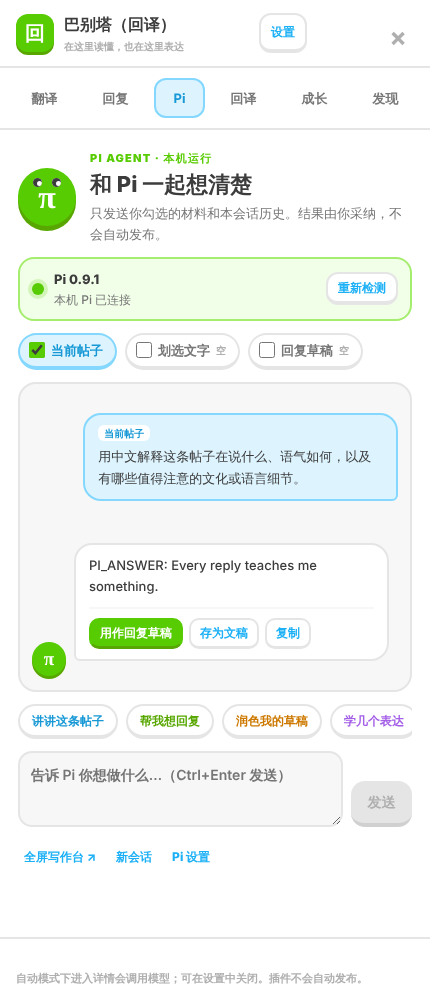
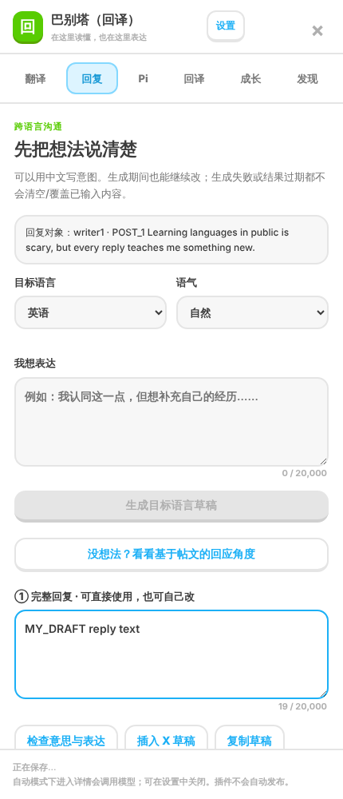
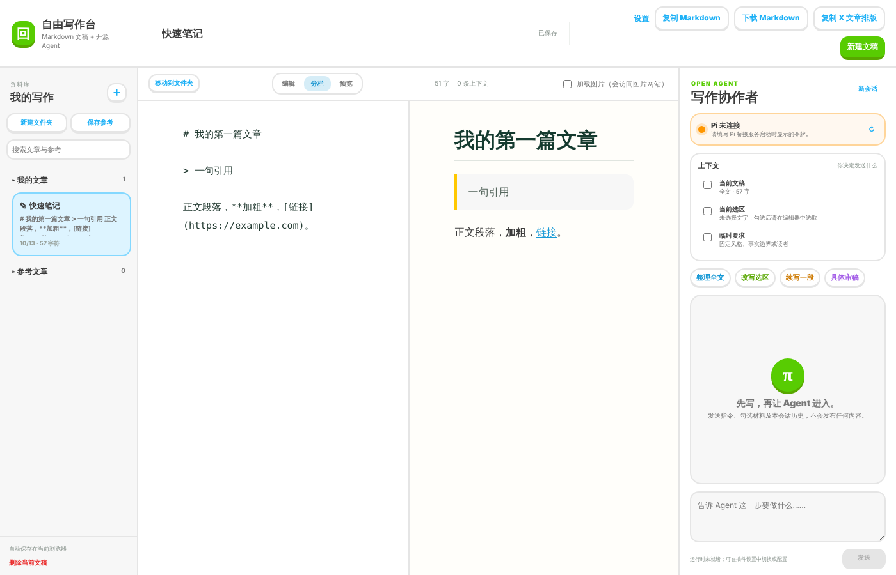

# 巴别塔（回译）

[](https://github.com/Kevin-Yixuan/babel-tower-backtranslation/actions/workflows/pr-tests.yml)
[](https://github.com/Kevin-Yixuan/babel-tower-backtranslation/releases)

在 X（Twitter）上读懂外语、用自己的话回复的浏览器扩展。阅读时翻译、查词、讲解句子；回复时先用中文说清想法，再生成目标语言草稿，并用「回译」核对意思有没有走样。附带 Markdown 写作台和本机 [Pi](https://pi.dev) 写作助手。

<p align="center">
  
  
  
</p>

## 功能

| | |
| --- | --- |
| **阅读** | 帖子和长文一键翻译，可选原文／译文语言、全文／划选／手动输入取材；划词查词（本地 MDX 词典优先，在线兜底）；句子讲解与收藏。超过 20,000 字符明确提示拆分，绝不静默截断。 |
| **回复** | 用中文写想法 → 目标语言完整草稿 → 中文回译、意思风险、逐项修改建议。插入 X 发帖框前必须确认，核对回复对象，跨帖拒绝，非空时追加。**扩展从不点击发布。** |
| **Pi 助手** | 侧栏和写作台都能与本机 Pi 对话；只发送你勾选的材料，结果由你采纳。 |
| **练习与成长** | 回译练习；只有你亲手写的稿件才进入学习记忆，AI 代写不算掌握证据。 |
| **写作台** | Markdown 文稿库、分栏预览、冲突副本保护、复制为 X 文章排版、下载 `.md`。 |
| **筛选（可选）** | Jev 规则折叠与兴趣高亮，默认关闭，有每日调用上限。 |

<p align="center"></p>

## 安装

1. 从 [Releases](https://github.com/Kevin-Yixuan/babel-tower-backtranslation/releases) 下载最新的 `babel-tower-backtranslation-*.zip`，解压到一个**长期不移动**的目录（第一层应是 `manifest.json`）。
2. 打开 `chrome://extensions` 或 `edge://extensions`，开启「开发者模式」，点「加载已解压的扩展程序」并选中该目录。
3. 刷新 `x.com`，帖子下会出现「翻译」「回复」。点扩展图标进入设置，选择模型服务商并填写自己的 API Key。

升级时把新版文件覆盖到**同一目录**再点「重新加载」，数据才会保留（不同目录会得到不同的扩展 ID）。扩展没有自动更新。详见 [安装与更新](安装与更新.md)。

### 连接 Pi 助手（可选）

```bash
# 先按 https://pi.dev/docs/latest/cli 安装并配置 Pi
node pi-bridge/server.mjs      # 仅监听 127.0.0.1:4097，启动时打印访问令牌
```

把令牌填进设置页「写作助手」，保存后点「授权并检测」。

## 隐私

没有开发者服务器，不含统计或追踪。API Key、草稿、收藏和词典索引只存在本机浏览器；内容只在你触发功能时发往**你自己配置**的模型服务。开启「自动翻译」后，打开帖子会自动发送原文，可能产生费用。详见 [privacy.md](privacy.md) 与 [权限说明](docs/PERMISSIONS.md)。

## 开发

无需构建，直接以「加载已解压的扩展程序」加载仓库目录即可调试。

```bash
npm test                              # Node 单元测试
node --test tests/packaging.test.mjs  # 打包与发布脚本测试
npm i -D playwright && npm run test:browser   # 隔离 Edge + 真实 MV3 扩展 + 仿真 X 页面
```

浏览器测试不访问真实 X、不使用真实密钥，只替换外部网络。也可用 `PLAYWRIGHT_PATH` 指向已安装的 Playwright。

```
background.js        MV3 后台：消息路由、模型请求、存储白名单
content.js           X 页面宿主：扫描帖子、帖内入口、编辑框跟踪
sidebar/             侧栏骨架（window.BX）、会话恢复、帖子身份
modules/<feature>/   各页签：reading · reply · agent · practice · growth · discovery
services/            设置、会话、备份、Pi 客户端等后台服务
write/               Markdown 写作台
pi-bridge/           本机 Pi 桥接服务（Node，无依赖）
mdx/                 本地 MDX 词典解析与索引
scripts/             打包、校验、版本门禁
```

架构与模块约定见 [docs/ARCHITECTURE.md](docs/ARCHITECTURE.md)，发布流程见 [docs/RELEASING.md](docs/RELEASING.md)，版本历史见 [CHANGELOG.md](CHANGELOG.md)。

## 反馈

请在 [Issues](https://github.com/Kevin-Yixuan/babel-tower-backtranslation/issues) 附上浏览器版本、复现步骤和去敏后的页面结构。不要上传密钥、令牌或私人帖子内容。
